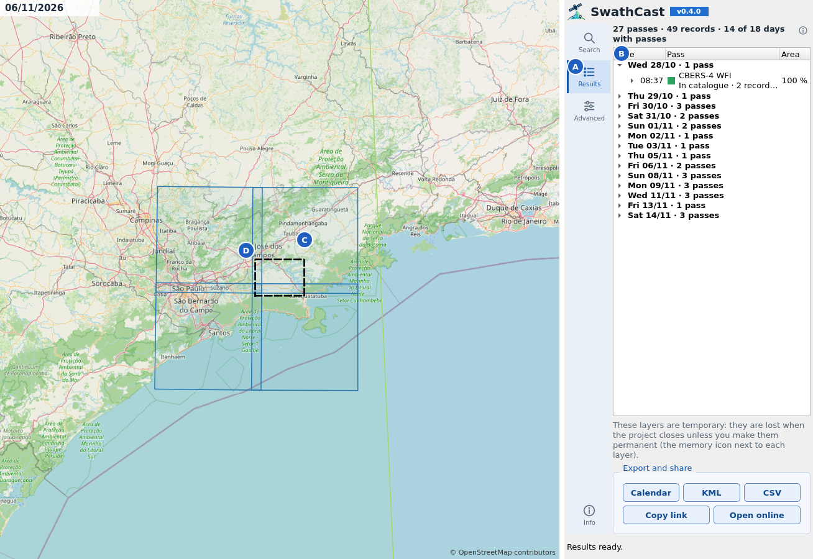
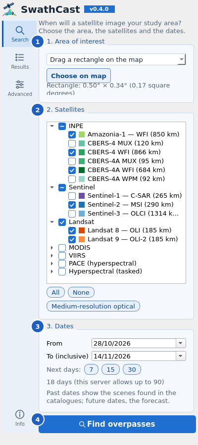
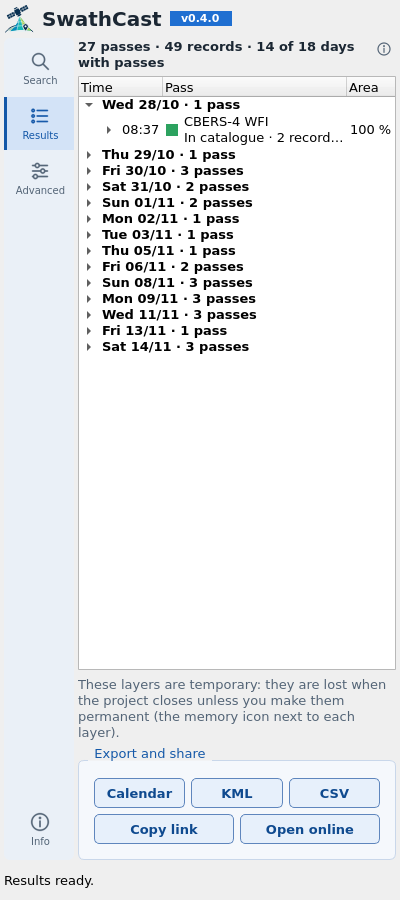
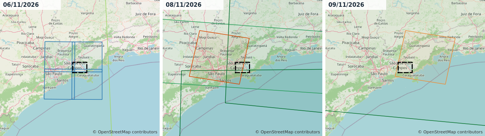

# SwathCast for QGIS

[](LICENSE)
[](https://qgis.org)

*Português: [README.pt-BR.md](README.pt-BR.md)*

**When will a satellite image your study area?** SwathCast forecasts the overpasses of
Sentinel-1/2/3, Landsat 8/9, CBERS-4/4A, Amazonia-1, MODIS (Terra/Aqua), VIIRS (Suomi NPP,
NOAA-20/21), PACE, EnMAP and PRISMA over a point, a rectangle or the polygons of a layer. For
dates already past, it lists the scenes the agencies' catalogues actually hold. The footprints go
on the map as a time-enabled layer, and every record says what it rests on: an operator's plan, a
repeat cycle, the orbit, or a product found in a catalogue.



*The Paraibuna reservoir (São Paulo). **A** the Results tab of the dock. **B** the passes by day,
with each record underneath. **C** the footprints of one day, here Sentinel-2 tiles. **D** the study
area. Base map © OpenStreetMap contributors.*

The plugin is a client of the public [swathview](https://swathview.pages.dev) server, which runs
the SwathCast forecasting package. It needs no extra Python packages.

## Install

1. Download `swathcast_qgis-<version>.zip` from the latest
   [release](https://github.com/Rogerio-floresjr/swathcast-qgis/releases/latest).
2. In QGIS: *Plugins › Manage and Install Plugins › Install from ZIP*, choose the file, *Install
   Plugin*.
3. A satellite button appears on the toolbar (also under *Web › SwathCast*).

**Requirements:**
- QGIS 3.28 or later (Qt5) or QGIS 4 (Qt6). Tested on 3.34, 3.40 LTR and 4.2.
- An internet connection.

## Tutorial: the next passes over a reservoir



1. **Area of interest.** Choose how to give the area:
   - click a point;
   - drag a rectangle;
   - use the map extent;
   - or use the selected features of a point or polygon layer, in any CRS.

   Then press *Choose on map*. The dock shows the size of the area.
2. **Satellites.** They are grouped as on the website, INPE first. *Medium-resolution optical*
   ticks Sentinel-2, Landsat 8/9, CBERS-4/4A WFI and Amazonia-1. *All* and *None* do what they say.
3. **Dates.** *To* is inclusive, and the *7*, *15* and *30* buttons start today.
   - Past dates show the scenes found in the catalogues; future dates, the forecast.
   - PRISMA has no public catalogue, so it keeps its forecast for past dates too.
4. **Find overpasses.** The first search after a quiet spell can wait up to a minute while the
   free server wakes.



5. **Read the passes.**
   - The Results tab groups the records into **passes**, one satellite imaging the area once, and
     lists them by day.
   - Each pass shows the share of the area it covers, from the union of its footprints.
   - Click a day, a pass or a record to flash it on the map; double-click to zoom.
6. **Export.**
   - *Calendar* saves an `.ics` file for Google, Outlook or Apple calendars, one event per record.
   - *KML* and *CSV* save the same records.
   - *Copy link* and *Open online* give the same search on the website, to share it.
7. **Keep the layers.** The layers are temporary memory layers. Use *Make Permanent* in QGIS to keep
   them, or *Export › Save Features As* for any other format.

## Tutorial: stepping through the days



The footprint layer is time-enabled. In the Temporal Controller (*View › Panels › Temporal
Controller*), press *Animated temporal navigation*, set the step to one day, and step through the
search window. The map shows only the footprints of that day.

**Colour** is by mission. The **outline** shows the kind of forecast:

| Outline | Meaning |
|---|---|
| solid | planned by the operator, archive-derived, orbit-derived, or in a catalogue |
| dashed | projected from the last known repeat cycle |
| dotted | tasking required: an image exists only if someone orders it (EnMAP, PRISMA) |

## Other features

- **Web links.** *Advanced › Open a link from the web app* takes a swathview address, fills the form
  and runs the same search.
- **Fields of the footprint layer:**
  - `pass_id`, `evidence` and `evidence_code`;
  - `tasking_required`;
  - `local_time` (in the computer's time zone);
  - `coverage_pct`, `cloud_cover` (catalogue scenes) and `sun_zenith_deg`;
  - the orbit and tile identifiers.
- **Limits checked before sending.** The dock checks the server's limits and explains a refusal in
  plain words.
- **Interface:** English and Portuguese, following the QGIS language; light and dark themes.
- **Self-hosting.** *Advanced* takes another server address and an API key, for a self-hosted
  swathview.

## Services used

| Service | Address | What for |
|---|---|---|
| swathview API | https://swathview-api.onrender.com | every search and every export (.ics, KML, CSV) |
| swathview site and documentation | https://swathview.pages.dev/docs#qgis | help, data sources, privacy and terms |

The plugin talks only to the swathview API. The server, in turn, reads public sources:
- orbital elements from CelesTrak (Space-Track as a fallback);
- ESA's acquisition plans and the USGS Landsat calendar;
- the Copernicus Data Space, NASA CMR, INPE (DGI and Brazil Data Cube) and DLR catalogues.

Their list, with licences and credits, is at
[swathview.pages.dev/docs#sources](https://swathview.pages.dev/docs#sources).

**What is sent:** the plugin sends the area, the dates and the satellites. The IP address and the
plugin's identification (its version and the QGIS version) go with every internet request. See the
[privacy notice](https://swathview.pages.dev/privacy) and the
[terms of use](https://swathview.pages.dev/terms).

## Using the API from Python

The plugin is one of three ways to reach the same service. The other two are the
[web app](https://swathview.pages.dev) and the swathview API itself, which any program can call. The
API's routes and fields are documented at
[swathview-api.onrender.com/docs](https://swathview-api.onrender.com/docs).

A search is a job: send it, then ask for its result until it is ready.

```python
import time, requests

API = "https://swathview-api.onrender.com/api"
req = {"target": {"type": "point", "lat": -23.45, "lon": -45.7},
       "satellites": ["sentinel-2", "landsat-8"],
       "start": "2026-11-10", "end": "2026-11-20"}
job = requests.post(f"{API}/predict", json=req, timeout=120).json()
while (r := requests.get(f"{API}/jobs/{job['job_id']}", timeout=60).json())["status"] in ("pending", "running"):
    time.sleep(2)
if r["status"] == "error":
    raise RuntimeError(r["error"])
for p in r["result"]["overpasses"]:
    print(p["timestamp_utc"], p["satellite"], p["grid_cell"], p["coverage_fraction"], p["evidence"])
```

Run on 6 November 2026, this printed three passes over the point: two Sentinel-2 (one *planned*, one
*cycle_projected*) and one Landsat 8 (*planned*).

- **Mission keys** (`"sentinel-2"`, `"cbers-4a"`, …) come from `GET /api/missions`.
- **The target** can also be `{"type": "bbox", "west": …, "south": …, "east": …, "north": …}`,
  `{"type": "geojson", "geometry": {…}}` or `{"type": "wkt", "wkt": "POLYGON (…)"}`.
- **Exports:** `GET /api/jobs/{job_id}/export/{fmt}`, with `fmt` one of `ical`, `kml`, `csv` or
  `geojson`.
- **Limits:** the same as the plugin's (below): 90 days, 100 square degrees, 1 square degree for PRISMA
  and EnMAP, 20 requests per minute.
- **No guarantee:** the hosting is free, with no availability guarantee, and the routes carry no
  version number, so they may change. The [terms of use](https://swathview.pages.dev/terms) and the
  [privacy notice](https://swathview.pages.dev/privacy) apply.

## Known limitations

**Limits of the public server:**
- at most 90 days per search;
- an area whose bounding box is at most 100 square degrees;
- PRISMA and EnMAP (computed on request) only for points or areas up to 1 square degree;
- 20 searches per minute.

**Free hosting.** There is no availability guarantee, and the first search after a quiet spell can
wait up to about a minute.

**Precision depends on how far ahead.**
- Within the operators' published plans (about two weeks for Sentinel-1/2), passes are *Planned*.
- Beyond that they are *Projected by cycle*.
- When a plan is published late, the first days are projected too.
- Orbit-derived times drift as the orbital elements age.

**Past dates come from the catalogues.**
- They show scenes that exist, not forecasts.
- Catalogues publish with a delay: INPE about 9–13 days, Landsat about 9 days. The last days of a
  past window can look empty.
- A large area or a long window can come back partial. The summary says how much was fetched, and
  searching again fetches the rest.

## Development

```
scripts/test.sh                  # QGIS 4.2 (conda env qgis-dev), offscreen
scripts/test.sh qgis-ltr         # QGIS 3.40 LTR (conda env qgis-ltr); qgis-334 = 3.34
SWATHCAST_LIVE=1 scripts/test.sh # also run the flow against the public server
scripts/i18n.sh                  # refresh and compile pt_BR and the English plural forms
scripts/screenshots.sh [pt_BR]   # render the README figures from a live search
scripts/package.sh               # build dist/swathcast_qgis-<version>.zip
```

How the code is laid out:
- `client.py` (HTTP, limits, polling, result joining) has no QGIS imports and is tested with plain
  Python.
- `compat.py` holds every API difference between QGIS 3 and 4.
- Network calls go through `QgsBlockingNetworkRequest` inside a `QgsTask`, so the user's proxy and
  SSL settings apply and the GUI never blocks.
- The colours and icons come from the shared SwathCast design tokens (`swathcast_qgis/design/`).

Releasing: [docs/RELEASING.md](docs/RELEASING.md).

## Author

Rogerio Flores Jr, rogerio.floresjr@gmail.com.

SwathCast is an independent project. It is not an official product of, nor affiliated with, ESA,
USGS, NASA, INPE, ASI or DLR, and its forecasts come with no guarantee. Do not use them for
operational tasking or safety-critical planning; confirm with the satellite's operator.

## Citation

See [CITATION.cff](CITATION.cff), or GitHub's *Cite this repository*.

## License

GPL-2.0-or-later (see [LICENSE](LICENSE)). Copyright (c) 2026 Rogerio Flores Jr. The SwathCast
name and icons are not covered by the licence. The plugin bundles no third-party libraries. The
figures contain map data © OpenStreetMap contributors.
