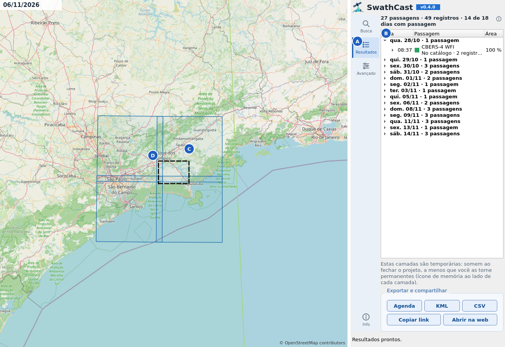
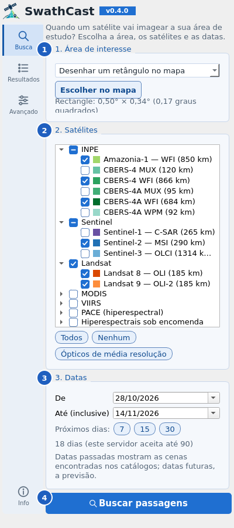
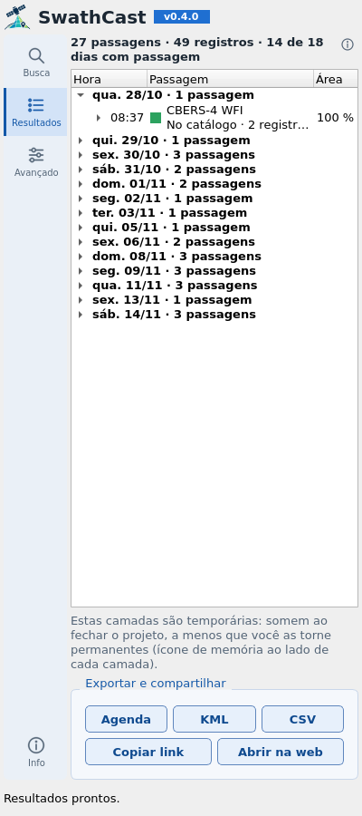
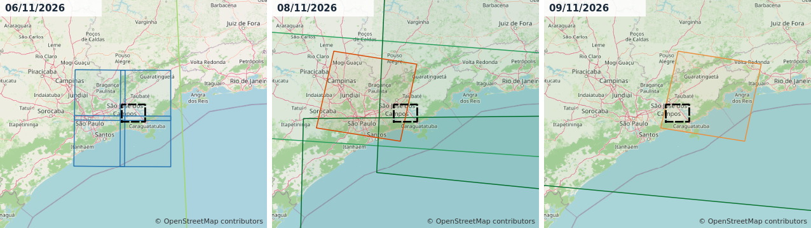

# SwathCast para QGIS

[](LICENSE)
[](https://qgis.org)

*English: [README.md](README.md)*

**Quando um satélite vai imagear a sua área de estudo?** O SwathCast prevê as passagens de
Sentinel-1/2/3, Landsat 8/9, CBERS-4/4A, Amazonia-1, MODIS (Terra/Aqua), VIIRS (Suomi NPP,
NOAA-20/21), PACE, EnMAP e PRISMA sobre um ponto, um retângulo ou os polígonos de uma camada. Para
datas já passadas, lista as cenas que os catálogos das agências de fato têm. Os footprints vão para o
mapa como uma camada temporal, e cada registro diz em que se apoia: plano do operador, ciclo de
repetição, órbita ou produto encontrado num catálogo.



*Represa de Paraibuna (SP). **A** a aba Resultados do painel. **B** as passagens por dia, com os
registros de cada uma. **C** os footprints de um dia, aqui tiles do Sentinel-2. **D** a área de
estudo. Mapa de fundo © colaboradores do OpenStreetMap.*

O complemento é um cliente do servidor público [swathview](https://swathview.pages.dev), que roda o
pacote de previsão SwathCast. Não precisa de nenhum pacote Python extra.

## Instalação

1. Baixe `swathcast_qgis-<versão>.zip` da
   [última versão](https://github.com/Rogerio-floresjr/swathcast-qgis/releases/latest).
2. No QGIS: *Complementos › Gerenciar e Instalar Complementos › Instalar a partir do ZIP*, escolha o
   arquivo e clique em *Instalar Complemento*.
3. Aparece um botão de satélite na barra de ferramentas (também em *Web › SwathCast*).

**Requisitos:**
- QGIS 3.28 ou mais novo (Qt5) ou QGIS 4 (Qt6). Testado no 3.34, 3.40 LTR e 4.2.
- Conexão com a internet.

## Tutorial: as próximas passagens sobre uma represa



1. **Área de interesse.** Escolha como informar a área:
   - clicar num ponto;
   - desenhar um retângulo;
   - usar a extensão do mapa;
   - ou usar as feições selecionadas de uma camada de pontos ou polígonos, em qualquer SRC.

   Depois clique em *Escolher no mapa*. O painel mostra o tamanho da área.
2. **Satélites.** Estão agrupados como no site, com o INPE primeiro. *Ópticos de média resolução*
   marca Sentinel-2, Landsat 8/9, CBERS-4/4A WFI e Amazonia-1. *Todos* e *Nenhum* fazem o que dizem.
3. **Datas.** O *Até* é inclusivo, e os botões *7*, *15* e *30* começam hoje.
   - Datas passadas mostram as cenas encontradas nos catálogos; datas futuras, a previsão.
   - O PRISMA não tem catálogo público, então mantém a previsão também no passado.
4. **Buscar passagens.** A primeira busca depois de um tempo parado pode esperar até um minuto,
   enquanto o servidor gratuito acorda.



5. **Leia as passagens.**
   - A aba Resultados agrupa os registros em **passagens**, ou seja, um satélite imageando a área
     uma vez, e as lista por dia.
   - Cada passagem mostra quanto da área ela cobre, pela união dos seus footprints.
   - Clique num dia, numa passagem ou num registro para destacá-lo no mapa; clique duas vezes para
     aproximar.
6. **Exporte.**
   - *Agenda* salva um arquivo `.ics` para as agendas do Google, Outlook ou Apple, com um evento por
     registro.
   - *KML* e *CSV* salvam os mesmos registros.
   - *Copiar link* e *Abrir na web* dão a mesma busca no site, para compartilhar.
7. **Guarde as camadas.** As camadas são temporárias, em memória. Use *Tornar permanente* no QGIS
   para guardá-las, ou *Exportar › Salvar feições como* para qualquer outro formato.

## Tutorial: passando os dias



A camada de footprints é temporal. No Controlador Temporal (*Exibir › Painéis › Controlador
Temporal*), ligue a *navegação temporal animada*, ponha o passo em um dia e avance pela janela da
busca. O mapa mostra só os footprints daquele dia.

A **cor** é por missão. O **contorno** mostra o tipo de previsão:

| Contorno | Significado |
|---|---|
| contínuo | planejada pelo operador, estimada pelo histórico, calculada pela órbita ou presente num catálogo |
| tracejado | projetada a partir do último ciclo de repetição conhecido |
| pontilhado | exige programação: só existe imagem se alguém encomendar (EnMAP, PRISMA) |

## Outros recursos

- **Links do site.** *Avançado › Abrir um link do app web* recebe um endereço do swathview, preenche
  o formulário e faz a mesma busca.
- **Campos da camada de footprints:**
  - `pass_id`, `evidence` e `evidence_code`;
  - `tasking_required`;
  - `local_time` (no fuso do computador);
  - `coverage_pct`, `cloud_cover` (cenas de catálogo) e `sun_zenith_deg`;
  - os identificadores de órbita e tile.
- **Limites conferidos antes de enviar.** O painel confere os limites do servidor e explica a recusa
  em palavras simples.
- **Interface:** português e inglês, conforme o idioma do QGIS; temas claro e escuro.
- **Servidor próprio.** Em *Avançado* dá para usar outro endereço de servidor e uma chave de API,
  para um swathview hospedado por você.

## Serviços usados

| Serviço | Endereço | Para quê |
|---|---|---|
| API do swathview | https://swathview-api.onrender.com | todas as buscas e exportações (.ics, KML, CSV) |
| site e documentação do swathview | https://swathview.pages.dev/docs#qgis | ajuda, fontes de dados, privacidade e termos |

O complemento só conversa com a API do swathview. O servidor, por sua vez, lê fontes públicas:
- elementos orbitais do CelesTrak (Space-Track como reserva);
- os planos de aquisição da ESA e o calendário Landsat da USGS;
- os catálogos do Copernicus Data Space, da NASA (CMR), do INPE (DGI e Brazil Data Cube) e do DLR.

A lista, com licenças e créditos, está em
[swathview.pages.dev/docs#sources](https://swathview.pages.dev/docs#sources).

**O que é enviado:** o complemento envia a área, as datas e os satélites. O endereço IP e a
identificação do complemento (a versão dele e a do QGIS) vão junto em qualquer acesso à internet.
Veja o [aviso de privacidade](https://swathview.pages.dev/privacidade) e os
[termos de uso](https://swathview.pages.dev/termos).

## Usando a API pelo Python

O complemento é uma de três formas de chegar ao mesmo serviço. As outras duas são o
[aplicativo web](https://swathview.pages.dev) e a própria API do swathview, que qualquer programa pode
chamar. As rotas e os campos da API estão documentados em
[swathview-api.onrender.com/docs](https://swathview-api.onrender.com/docs).

Uma busca é um trabalho (*job*): envie-a e peça o resultado até ele ficar pronto.

```python
import time, requests

API = "https://swathview-api.onrender.com/api"
req = {"target": {"type": "point", "lat": -23.45, "lon": -45.7},
       "satellites": ["sentinel-2", "landsat-8"],
       "start": "2026-11-10", "end": "2026-11-20"}
job = requests.post(f"{API}/predict", json=req, timeout=120).json()
while (r := requests.get(f"{API}/jobs/{job['job_id']}", timeout=60).json())["status"] in ("pending", "running"):
    time.sleep(2)
if r["status"] == "error":
    raise RuntimeError(r["error"])
for p in r["result"]["overpasses"]:
    print(p["timestamp_utc"], p["satellite"], p["grid_cell"], p["coverage_fraction"], p["evidence"])
```

Rodado em 6 de novembro de 2026, o exemplo mostrou três passagens sobre o ponto: duas do Sentinel-2
(uma *planned*, prevista no plano, e uma *cycle_projected*, projetada pelo ciclo) e uma do Landsat 8
(*planned*).

- **As chaves das missões** (`"sentinel-2"`, `"cbers-4a"`, …) vêm de `GET /api/missions`.
- **O alvo** também pode ser `{"type": "bbox", "west": …, "south": …, "east": …, "north": …}`,
  `{"type": "geojson", "geometry": {…}}` ou `{"type": "wkt", "wkt": "POLYGON (…)"}`.
- **Exportações:** `GET /api/jobs/{job_id}/export/{fmt}`, com `fmt` igual a `ical`, `kml`, `csv` ou
  `geojson`.
- **Limites:** os mesmos do complemento (abaixo): 90 dias, 100 graus quadrados, 1 grau quadrado para
  PRISMA e EnMAP, 20 pedidos por minuto.
- **Sem garantia:** a hospedagem é gratuita, sem garantia de disponibilidade, e as rotas não têm número
  de versão, então podem mudar. Valem os [termos de uso](https://swathview.pages.dev/termos) e o
  [aviso de privacidade](https://swathview.pages.dev/privacidade).

## Limitações conhecidas

**Limites do servidor público:**
- no máximo 90 dias por busca;
- uma área cujo retângulo envolvente tenha no máximo 100 graus quadrados;
- PRISMA e EnMAP (calculados na hora) só para pontos ou áreas de até 1 grau quadrado;
- 20 buscas por minuto.

**Hospedagem gratuita.** Não há garantia de disponibilidade, e a primeira busca depois de um tempo
parado pode esperar até cerca de um minuto.

**A precisão depende da distância no tempo.**
- Dentro dos planos publicados pelos operadores (cerca de duas semanas no Sentinel-1/2), as passagens
  são *Planejadas*.
- Depois disso, são *Projetadas por ciclo*.
- Quando um plano sai atrasado, os primeiros dias também ficam projetados.
- Os horários calculados pela órbita derivam conforme os elementos orbitais envelhecem.

**Datas passadas vêm dos catálogos.**
- Mostram cenas que existem, não previsões.
- Os catálogos publicam com atraso: INPE cerca de 9–13 dias, Landsat cerca de 9 dias. Os últimos dias
  de uma janela passada podem parecer vazios.
- Uma área grande ou uma janela longa podem voltar parciais. O resumo diz quanto foi buscado, e uma
  nova busca traz o resto.

## Desenvolvimento

```
scripts/test.sh                  # QGIS 4.2 (ambiente conda qgis-dev), fora da tela
scripts/test.sh qgis-ltr         # QGIS 3.40 LTR (ambiente conda qgis-ltr); qgis-334 = 3.34
SWATHCAST_LIVE=1 scripts/test.sh # roda também o fluxo contra o servidor público
scripts/i18n.sh                  # atualiza e compila o pt_BR e os plurais em inglês
scripts/screenshots.sh [pt_BR]   # gera as figuras do README a partir de uma busca real
scripts/package.sh               # gera dist/swathcast_qgis-<versão>.zip
```

Como o código está organizado:
- `client.py` (HTTP, limites, consulta e junção dos resultados) não importa o QGIS e é testado com
  Python puro.
- `compat.py` concentra as diferenças de API entre o QGIS 3 e o 4.
- As chamadas de rede passam por `QgsBlockingNetworkRequest` dentro de uma `QgsTask`, então valem o
  proxy e o SSL configurados pelo usuário e a interface nunca trava.
- As cores e os ícones vêm dos tokens de design compartilhados do SwathCast
  (`swathcast_qgis/design/`).

Como lançar versões: [docs/RELEASING.md](docs/RELEASING.md).

## Autor

Rogerio Flores Jr, rogerio.floresjr@gmail.com.

O SwathCast é um projeto independente. Não é produto oficial da ESA, USGS, NASA, INPE, ASI ou DLR,
nem tem vínculo com elas, e as previsões não têm garantia. Não use para programação operacional nem
para planejamento crítico de segurança; confirme com o operador do satélite.

## Citação

Veja [CITATION.cff](CITATION.cff), ou *Cite this repository* no GitHub.

## Licença

GPL-2.0-or-later (veja [LICENSE](LICENSE)). Copyright (c) 2026 Rogerio Flores Jr. O nome e os
ícones do SwathCast não estão cobertos pela licença. O complemento não inclui bibliotecas de
terceiros. As figuras contêm dados de mapa © colaboradores do OpenStreetMap.
